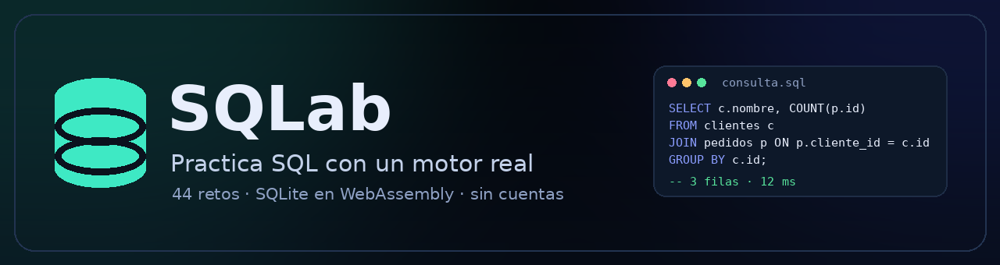

# SQLab



**En línea:** <https://sergarb1.github.io/sqlab/> · **Código:** <https://github.com/sergarb1/sqlab>

**Autor:** Sergi Garcia Barea · [mejoratudocencia.es](https://mejoratudocencia.es)

Laboratorio para practicar SQL con un motor **SQLite real** (compilado a WebAssembly con
[sql.js](https://sql.js.org)) que se ejecuta dentro del navegador. Sin backend, sin cuentas y sin
enviar consultas a ningún servidor.

> **Licencia:** GNU Affero General Public License v3.0 · © 2026 Sergi Garcia Barea.
> Ver [LICENSE](LICENSE).

## Cómo abrirlo

- **Doble clic en `index.html`**: funciona directamente porque el WASM va embebido en
  `vendor/sql-wasm-base64.js`.
- **Con un servidor local** (recomendado para desarrollo):

  ```bash
  python3 -m http.server 8000
  # abre http://localhost:8000
  ```

- **GitHub Pages**: sube el contenido del proyecto y activa Pages; no hace falta configurar nada más.
- **Instalada como app**: ver [Instalación como app (PWA)](#instalación-como-app-pwa).

## Qué incluye

- **44 retos** en cuatro niveles (Fácil, Medio, Avanzado y ⭐ Reto 10) sobre una base de datos de
  tienda con 7 tablas relacionadas: `clientes`, `productos`, `categorias`, `pedidos`,
  `lineas_pedido`, `empleados`, `departamentos` y `departamentos`.
- **Corrección automática**: tu consulta se ejecuta de verdad y su resultado se compara con el de
  la solución oficial (calculado en tiempo de ejecución). El orden solo cuenta cuando el enunciado
  lo exige, y se toleran empates.
- **Editor con resaltado de sintaxis**, atajos (`Ctrl`/`Cmd` + `Enter` para ejecutar, `Tab` para
  indentar) y borradores guardados por reto.
- **Pistas y solución** en cada ejercicio, con una explicación breve al acertar.
- **Laboratorio libre**: escribe cualquier sentencia (incluido `CREATE TABLE` / `INSERT`) sobre la
  misma base de datos, navega el esquema y restaura los datos originales cuando quieras.
- **Progreso en `localStorage`** (se ve en la barra superior, en cada nivel y en la portada).
- **Tema oscuro y claro** conmutable, con la preferencia guardada.
- **Portada con navegación por secciones**, tabla de ejemplo real, progreso por nivel, atajos y
  preguntas frecuentes.
- **Instalable como PWA** y utilizable sin conexión después de la primera visita.

En los retos solo se permiten consultas de lectura; las escrituras se reservan al laboratorio para
no romper el estado de la base de datos.

## Portada y tema

La entrada es una portada independiente de la aplicación:

- **Hero** con la llamada a la acción y estadísticas (retos, niveles, tablas y retos resueltos).
- **Consulta de ejemplo** ejecutada de verdad contra `tienda.db` al cargar: no es una captura.
- **Progreso por nivel** con barras, contador (`3 / 12`) y marca ✓ al completar un nivel.
- **Características**, **cómo se practica**, **atajos**, **preguntas frecuentes** y un cierre con CTA.
- **Navegación por anclas** en la barra superior (`Retos · Características · Cómo · Atajos · FAQ · Motor`),
  oculta dentro de la aplicación y en pantallas estrechas.

El botón ☀/☾ alterna entre tema oscuro (por defecto) y claro. La elección se guarda en
`localStorage` (`sqlab.theme.v1`), se aplica **antes de pintar** para evitar destellos y actualiza
`<meta name="theme-color">` para que la barra del navegador combine con la interfaz.

## Atajos de teclado

| Atajo | Acción |
| --- | --- |
| `Ctrl`/`Cmd` + `Enter` | Ejecutar la consulta del editor |
| `Tab` | Indentar dos espacios en la posición del cursor |

El resto de acciones (solución, limpiar, siguiente reto, restaurar datos) tienen botón propio en la
interfaz.

## Instalación como app (PWA)

Sobre `https://` o `localhost` la aplicación se puede instalar; desde `file://` funciona igual pero
sin service worker:

1. Pulsa **Instalar** en la barra superior cuando aparezca (o el icono de instalación del navegador).
2. En Android: menú ⋮ → «Instalar aplicación». En iOS: Compartir → «Añadir a pantalla de inicio».

`manifest.webmanifest` define nombre, iconos, colores y modo `standalone`. `sw.js` precachea la
interfaz, los datos y el WASM, sirve la portada cacheada cuando no hay red y actualiza el resto de
archivos en segundo plano. Al cambiar archivos, sube `VERSION` en `sw.js` para invalidar la caché.

## Preguntas frecuentes

**¿Necesito instalarlo o crear una cuenta?** No. Se abre en el navegador y funciona sin registro;
el motor SQLite viaja con la página. Instalarla es opcional.

**¿Dónde se guarda mi progreso?** En este dispositivo, en el almacenamiento local del navegador:
retos resueltos y borrador de cada consulta. Nada se envía a ningún servidor. «Reiniciar progreso»
lo borra, y también desaparece si limpias los datos del navegador.

**¿Puedo romper la base de datos?** En los retos no: solo se permiten consultas de lectura. En el
laboratorio puedes crear, insertar y borrar, y «Restaurar datos» devuelve `tienda.db` a su estado
original al instante.

**¿Funciona sin conexión?** Sí, después de la primera visita, gracias al service worker. También
funciona con doble clic en `index.html`, aunque ahí no se instala.

**¿Cómo corrige mi consulta?** Se ejecuta contra una copia limpia de la base de datos y se compara
con el resultado de la solución oficial, sin importar el orden salvo cuando el enunciado lo exige;
en ese caso se comprueba la columna pedida tolerando los empates.

**¿Es gratis? ¿Con qué licencia?** Sí: sin anuncios, cuentas ni límites. El código está publicado con
licencia AGPL-3.0, © 2026 Sergi Garcia Barea.

## Estructura

```
index.html                 estructura de la interfaz
styles.css                 estilos
data.js                    esquema, datos de ejemplo y catálogo de retos
app.js                     motor, ejecución, comparación y progreso
vendor/sql-wasm.js         sql.js (SQLite → WebAssembly)
vendor/sql-wasm-base64.js  el binario WASM embebido, para funcionar desde file://
vendor/sql-wasm.wasm       binario original (referencia / uso con servidor)
manifest.webmanifest       datos de instalación de la PWA
sw.js                      service worker (caché y uso sin conexión)
icons/                     iconos de la app (192, 512, maskable y apple-touch)
assets/banner.png          imagen de cabecera de este README
AGENTS.md                  guía para agentes y colaboradores
HANDS-OFF.md               límites del proyecto (autoría y licencia)
```

## Añadir un reto

Añade un objeto a `exercises` en `data.js`:

```js
{
  id: 'm15', level: 2, title: 'Título corto',
  prompt: 'Enunciado con las columnas esperadas.',
  tables: ['pedidos'], hint: 'Pista opcional.',
  lesson: 'Idea que se aprende al resolverlo.',
  solution: 'SELECT ...;'
}
```

El resultado esperado **no** se escribe a mano: se ejecuta `solution` contra una copia limpia de la
base de datos al cargar la página. Si el reto exige un orden concreto, añade `ordered: true` y
`orderBy: 'columna'`, `orderDir: 'asc' | 'desc'` para comparar solo esa columna.

## Licencia

Copyright (C) 2026 **Sergi Garcia Barea** · [mejoratudocencia.es](https://mejoratudocencia.es).

Este proyecto se distribuye bajo la **GNU Affero General Public License v3.0** (AGPL-3.0-or-later).
Puedes usarlo, estudiarlo, modificarlo y redistribuirlo siempre que conserves la licencia y el
autoría, y si lo publicas como servicio en red debes ofrecer el código fuente a sus usuarios.
El texto completo está en [LICENSE](LICENSE):

- Repositorio: <https://github.com/sergarb1/sqlab>
- Licencia: <https://www.gnu.org/licenses/agpl-3.0.html>

El aviso de autoría y licencia debe mantenerse también en `AGENTS.md`, `HANDS-OFF.md` y en el
pie de la web. Las condiciones para colaboradores y agentes están en [AGENTS.md](AGENTS.md) y en
[HANDS-OFF.md](HANDS-OFF.md).

Las dependencias de terceros conservan sus propias licencias: [sql.js](https://github.com/sql-js/sql.js)
(MIT) y [SQLite](https://www.sqlite.org/copyright.html) (dominio público).
